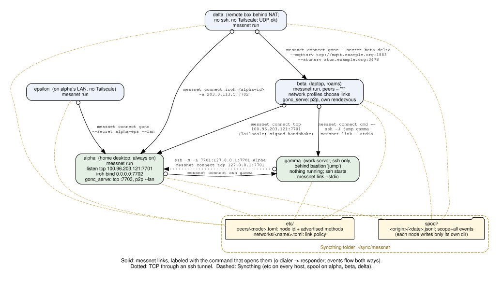

#+title: messnet design
#+options: toc:2

* Overview

messnet moves small JSON *events* between *nodes* (one per host or
account).  Each node keeps every event it knows in a local store and
exchanges missing events with peers over *links*.  Any two-way byte
stream can carry a link (TCP, ssh, any stdio command, iroh, gonc), and a
Syncthing-shared folder adds a slow but always-available path.
Syncthing also distributes each node's identity and reachability (the
=etc= directory) so peer-to-peer transports need no public discovery
service.

See [[file:connectivity.org]] for step-by-step setup and [[file:plan.org]]
for the protocol and implementation details.

* Example deployment

Five hosts with different network situations.  Each solid edge is a
messnet link, labeled with the command that opens it once (=messnet
connect …=).  The same link can be made persistent with =messnet config
add --host <responder> …= on the dialer, or by advertising it on the
responder (=messnet config add …=) and letting =messnet run= pick it.
Arrows point from dialer (o) to responder.  Every link carries events
*both* ways.

#+begin_src dot :file design.svg :exports results
digraph messnet {
  graph [rankdir=TB, fontname="Helvetica", fontsize=11, nodesep=0.7, ranksep=1.0, pad=0.3, newrank=true,
         label="Solid: messnet links, labeled with the command that opens them (o dialer -> responder; events flow both ways).\nDotted: TCP through an ssh tunnel.  Dashed: Syncthing (etc on every host, spool on alpha, beta, delta).",
         labelloc=b];
  node  [shape=box, style="rounded,filled", fontname="Helvetica", fontsize=10, fillcolor="#eef3fb"];
  edge  [fontname="Courier", fontsize=9, dir=both, arrowtail=odot, arrowhead=normal];

  beta  [label="beta  (laptop, roams)\nmessnet run, peers = \"*\"\nnetwork profiles choose links\ngonc_serve: p2p, own rendezvous"];
  delta [label="delta  (remote box behind NAT;\nno ssh, no Tailscale; UDP ok)\nmessnet run"];
  eps   [label="epsilon  (on alpha's LAN, no Tailscale)\nmessnet run"];
  alpha [label="alpha  (home desktop, always on)\nmessnet run\nlisten tcp 100.96.203.121:7701\niroh bind 0.0.0.0:7702\ngonc_serve: tcp :7703, p2p --lan", fillcolor="#e3f0e3"];
  gamma [label="gamma  (work server, ssh only,\nbehind bastion 'jump')\nnothing running; ssh starts\nmessnet link --stdio", fillcolor="#e3f0e3"];

  subgraph cluster_sync {
    label="Syncthing folder ~/sync/messnet"; style="rounded,dashed"; color="#aa8800"; fontcolor="#886600"; fontsize=10;
    etc   [label="etc/\npeers/<node>.toml: node id + advertised methods\nnetworks/<name>.toml: link policy", shape=folder, fillcolor="#fff7e0"];
    spool [label="spool/\n<origin>/<date>.jsonl: scope=all events\n(each node writes only its own dir)", shape=folder, fillcolor="#fff7e0"];
  }

  {rank=min; delta;}
  {rank=same; beta; eps;}
  {rank=same; alpha; gamma;}
  {rank=sink; etc; spool;}

  beta  -> alpha [label="messnet connect tcp\n100.96.203.121:7701\n(Tailscale; signed handshake)"];
  beta  -> gamma [label="messnet connect cmd --\nssh -J jump gamma\nmessnet link --stdio"];
  delta -> alpha [label="messnet connect iroh <alpha-id>\n-a 203.0.113.5:7702"];
  eps   -> alpha [label="messnet connect gonc\n--secret alpha-eps --lan"];
  delta -> beta  [label="messnet connect gonc --secret beta-delta\n--mqttsrv tcp://mqtt.example.org:1883\n--stunsrv stun.example.org:3478"];
  alpha -> gamma [label="messnet connect ssh gamma"];
  gamma -> alpha [label="ssh -N -L 7701:127.0.0.1:7701 alpha\nmessnet connect tcp 127.0.0.1:7701", style=dotted, constraint=false];

  edge [style=dashed, color="#c8a840", arrowtail=none, arrowhead=none, penwidth=0.8];
  alpha -> etc; gamma -> etc; beta -> etc; delta -> etc; eps -> etc;
  alpha -> spool; beta -> spool; delta -> spool;
}
#+end_src

#+RESULTS:

Regenerate the figure with =dot -Tsvg= on the block above (or =C-c C-c=
in Emacs).

** Hosts

| host    | situation                                  | runs                         | reachable by                    |
|---------+--------------------------------------------+------------------------------+---------------------------------|
| alpha   | home desktop, always on, LAN + Tailscale   | =messnet run= (listeners)    | tcp, ssh, iroh, gonc            |
| beta    | laptop, changes networks                   | =messnet run=, =peers="*"=   | gonc p2p (self-hosted rendezvous) |
| gamma   | work server, ssh only via bastion =jump=   | nothing; ssh starts a link   | ssh, ssh -J                     |
| delta   | behind NAT, no ssh or Tailscale, UDP works | =messnet run=                | (dials out only)                |
| epsilon | on alpha's LAN, no Tailscale               | =messnet run=                | (dials out only)                |

** Edges

| edge          | transport                  | encrypted by     | peer authenticated by                 | third parties              |
|---------------+----------------------------+------------------+---------------------------------------+----------------------------|
| beta→alpha    | TCP over Tailscale         | WireGuard        | messnet signed handshake (node id)    | Tailscale coordination     |
| beta→gamma    | ssh via bastion (=cmd=)    | ssh              | ssh host key + account                | the bastion                |
| alpha→gamma   | ssh stdio                  | ssh              | ssh host key + account                | none                       |
| gamma→alpha   | TCP through =ssh -L=       | ssh              | ssh, then signed handshake            | none                       |
| delta→alpha   | iroh (QUIC, direct UDP)    | QUIC/TLS 1.3     | iroh endpoint id = node id, checked against =etc= | none (relays off)          |
| epsilon→alpha | gonc p2p, LAN discovery    | TLS (PSK)        | shared secret                         | none (LAN broadcast)       |
| delta→beta    | gonc p2p, own rendezvous   | TLS/DTLS (PSK)   | shared secret                         | your MQTT and STUN servers |
| all → etc     | Syncthing                  | Syncthing TLS    | Syncthing device ids                  | Syncthing relays/discovery |
| some → spool  | Syncthing                  | Syncthing TLS    | Syncthing device ids                  | Syncthing relays/discovery |

Events reach nodes without a direct link by store-and-forward: a node
passes on what it receives.  For example, epsilon's events reach gamma via
alpha, and delta's reach gamma via alpha or beta.  Events also arrive
through the shared spool.  Duplicates are dropped by =(origin, scope, seq)=.

* Event flow

- =messnet emit= assigns the next =seq= in the node's =(origin, scope)=
  *stream* and appends the event to a spool file.  =all= events go to the
  shared spool, =lan= and =host= events to a local unsynced spool.  The
  event is also stored in the local SQLite store.
- A link starts with each side sending =hello= (node name, id, nonce and
  version vector) and =auth= (a signature over the peer's nonce).  Each
  side then sends what the other's version vector lacks, then forwards
  new events as they are stored.
- *Scope* limits travel.  =host= events never leave the node.  =lan=
  events cross only links with link scope =lan=.  =all= events go
  anywhere.  A link's scope is the narrower of its configured scope and
  the current network profile's.
- Consumers read the store (=messnet tail=) or the per-key latest-state
  files (=~/.cache/messnet/state/…=).

* Storage: spool, store and state

A node keeps three kinds of files.  They are three stages of one
pipeline: a /log/, an /index/ over the log, and a /projection/ of the
index.

| | spool | store | state |
|-|-|-|-|
| what | append-only JSONL, one file per origin per day | SQLite index of every event the node knows | newest event per =(type, origin, subject)=, one JSON file each |
| written by | the node, for its /own/ events only | =emit=, spool ingest, events received over links | the maintenance loop, from the store |
| read by | ingest; Syncthing | =tail=, replication, =vv=, =gaps=, the state builder | prompts and panels, with no messnet process |
| shared between hosts | the =all= spool, if it is a Syncthing folder | never | never |
| default place | =$XDG_DATA_HOME/messnet/spool= (and an unsynced =local_spool= under =$XDG_STATE_HOME=) | =$XDG_DATA_HOME/messnet/messnet.db= | =$XDG_CACHE_HOME/messnet/state= |
| lose it, and... | your own history is gone | rebuilt from the spools (see below) | rebuilt from the store |

** Spool: the durable record

- =all= events go to =<spool>/<origin>/<date>.jsonl=.  A node writes only
  its own origin directory, so Syncthing can share the folder with no write
  conflicts; this is a second way events travel, beside live links.
- =lan= and =host= events go to the unsynced =local_spool/{lan,host}=, so
  those scopes cannot leak through Syncthing.
- It holds the node's own events (all three scopes) and, in a shared
  folder, other nodes' =all= events as Syncthing delivers them.
- It also guards sequence numbers: =emit= allocates
  =max(store, spool) + 1=, so losing the database cannot reuse a =seq=.

** Store: the node's working knowledge

- Everything the node has: its own events, spool files ingested from
  other nodes, and events received over links.  =(origin, scope, seq)= is
  the key, so the same event arriving two ways is kept once.
- It answers version vectors, queries and replay, and the live-push
  pollers watch its rowid.  It also holds bookkeeping: spool file offsets,
  the state cursor and the prune /floors/.
- Writers (the =emit= command, the daemon) coordinate through
  =BEGIN IMMEDIATE= transactions.

*Events received over links go to the store and nowhere else.*  The
spool is where a node records /its own/ events; relaying other nodes'
events into it would make a node write another origin's directory and
break the Syncthing guarantee.  The consequence is that the store is a
cache only for what also reached a spool.  Events that arrived only over
a link (another node's =lan= events, or its =all= events on a host
without Syncthing) are gone if the store is rebuilt; =messnet rebuild=
moves the old database aside, and peers resend what they still have when
the nodes next link.  A rebuild also forgets the prune floors, so events
pruned from the store but still present in a spool come back (=prune
--spool= deletes this node's own spool files).

** State: a projection for readers that should not need messnet

- One small file per key, =<state>/<type>/<origin>/<subject>.json=,
  holding the whole newest event.  Covers every origin and scope the node
  knows, so a prompt can show another host's backups.
- It exists so consumers need no SQLite and keep working offline.
  Disposable: =messnet state update --rebuild= recreates it.
- Pruning leaves it alone, so a status can outlive the events that made
  it.  It keeps no history; for that use =messnet tail= (store) or the
  spool.

*State files are only as fresh as the last maintenance pass.*  Receiving
an event updates the store at once, but the state file changes when the
maintenance loop next runs (ingest the spools, then write state for new
rows).  Running =messnet serve= (or =run=) keeps that loop going, so a
host that wants its prompt to follow events arriving from elsewhere
should run it; see the next section.  =messnet state update= does one
pass by hand.

* Keeping a node running

A node that is not running neither receives events from its links nor
refreshes its state files.  =messnet install TARGET= arranges for
=messnet serve= to be running, and for it to start again after a crash or
a reboot:

#+begin_example
messnet install cron         # crontab entries
messnet install systemd      # a user service (+ lingering)
messnet install --list       # what is installed, and whether serve is running
messnet uninstall cron       # undo; not installed is a successful no-op
#+end_example

=messnet serve= with no =-l= is the whole node service (what =run= does:
maintenance, configured listeners, links, peer manager); with =-l= it
listens on just those addresses.

** One instance, so starting is always safe

=serve= and =run= take an exclusive =flock= on =<db>.serve.lock= (next to
the store, so it means "one service per store").  A second start finds the
lock held, does nothing and exits successfully.  The kernel drops the lock
when its holder dies, so a crash or reboot leaves nothing stale.  That is
what makes both mechanisms below idempotent at run time: cron may start it
every few minutes, systemd and cron may both be installed, and a person may
type =messnet serve= at any time.

** Idempotent installation

Each step checks what is already in place and does only what is missing, so
=install= can be rerun freely and a second run changes nothing.

- *cron* adds one marker-delimited block to the user's crontab: an
  =@reboot= line (cron runs it at boot with no login at all) and a
  periodic line (default every 10 minutes, =--interval=) that restarts
  the service if it died.  Everything else in the crontab is left alone,
  the block is replaced in place if it differs, and removing it restores
  the crontab as it was.  The lines carry a fixed =PATH= and absolute paths
  because cron has almost no environment.
- *systemd* writes =~/.config/systemd/user/messnet.service= (=Restart=on-failure=,
  =WantedBy=default.target=), runs =daemon-reload= only if the file
  changed, =enable= only if not enabled, =start= only if not running (and
  =restart= if the file changed under a running service), and enables
  /lingering/.  Without lingering the user's service manager starts at
  first login; with it, at boot.  A login by any route (graphical, console,
  ssh) is then irrelevant, and not logging in for days is fine.  If lingering
  cannot be enabled (it can need =sudo loginctl enable-linger USER=), install
  says so; the unit still works from the first login, and =install cron=
  covers the gap.  A =messnet.service= that was not made by =install= is
  never overwritten or removed.
- Both targets run =messnet serve= with the global options given before
  =install= (=-c=, =--node=, =--db=, ...; =$MESSNET_CONFIG= counts as =-c=)
  and with the absolute path of the executable (=--exe= to override), since
  neither has the environment of your shell.

** Limits

- Per user only; no system-wide units or root crontab.
- =uninstall systemd= leaves lingering on (other services may rely on it).
- The service needs =ssh=, =gonc= and so on on its =PATH=.  Under systemd
  that is the user manager's =PATH= (see =systemctl --user show-environment=);
  under cron it is =~/.local/bin:/usr/local/bin:/usr/bin:/bin=.  Setting
  =gonc_bin= to an absolute path avoids the question.

** Logging

=serve= and =run= log to a rotating file, =~/.cache/messnet/serve.log=
(1 MiB, three old copies), at =info= level: start and stop, listeners
and links coming and going, peers linked and unlinked, configuration
reloads and why one was refused.  Under cron nobody reads stderr, so this
is where to look.  The same warnings still go to stderr.  A duplicate start
that finds the lock held writes nothing, so cron's periodic check does not
fill the log.

#+begin_example
messnet config set log_level debug     # off | error | warning | info | debug; live
messnet config set log /path/serve.log # where; live
messnet install --list                 # shows the path while the file exists
#+end_example

* Following configuration changes

A running =serve= follows the configuration; nothing needs restarting for
the usual changes.  Edit =config.toml= by hand, or use =messnet config
set|add|remove=, and within a few seconds the service starts the listeners
and links that are new, stops those that are gone, and leaves the rest and
their connections untouched.  =messnet config add tcp ADDR= on a running
node makes it listen and publishes the new endpoint in its peer file;
=messnet config remove= makes it stop.

** What is followed

| change | effect, without a restart |
|-|-|
| =listen= entry added / removed | listener opened / closed, and the sessions it accepted are ended |
| =[[links]]= entry added / removed | that link started / ended |
| =[[gonc_serve]]= entry added / removed | responder started / stopped |
| =peers= set, changed or emptied | link manager started, re-plans at once, or stopped (its links dropped) |
| =advertise= | peer file rewritten (which Syncthing carries to the others) |
| =iroh.listen= (or advertising iroh) | iroh listener started / stopped |
| =tcp_auth=, =network=, =manage_interval=, =poll=, =gonc_bin=, =secrets=, =iroh.allow= / =iroh.scope= | used from the next connection or pass |
| =log=, =log_level= | log file moved / level changed |
| a file in =etc/peers= or =etc/networks= | the link manager re-plans at once (it also does every =manage_interval=) |
| a peer removed from =etc/peers=, or its =id= changed | its authenticated TCP / iroh session is ended |

*Not followed*: =node=, =spool=, =local_spool=, =db=, =state=, =etc=, =key=
and iroh's =bind= / =relays=.  They are opened once and the rest of the
service depends on them.  Changing one is logged as needing a restart and the
running value is kept, so the service stays consistent; the rest of the same
edit is still applied.  Environment variables and command line options given
to =serve= are as at startup and still win over the file.

** How it stays safe

An editor, a script or Syncthing can leave a file half written, briefly
missing or wrong, and the service must not turn that into dropped
connections.  So:

- *Settle first.* A changed file is applied only when the same content is seen
  on two looks in a row (2 s apart).  =kill -HUP= applies at once.
- *All or nothing.* The new file is parsed and every link, listener and
  responder in it is validated before anything changes.  A file that does not
  parse, or contains a bad entry, is rejected whole, said once in the log, and
  the running configuration stays; the next valid save is picked up.
- *A missing file is ignored* (it is not the same as an empty one, which
  would mean "stop everything").
- *Do not cut a working link for an unrelated change.* When the manager's
  plan changes, a link in use stays unless its own endpoint left the plan; new
  endpoints are used the next time that peer must be dialed.  A plan change is
  acted on only after it comes out the same twice, so a peer file seen
  half-written, or a flapping network, does not tear links down.  (Narrowing
  the scope of inbound links on a less trusted network is never delayed.)
- *Revocation needs two looks too.* A session is ended for lack of
  authorisation only if the peer directory fails to authorise it on two
  checks in a row.  Links that are authenticated outside the directory (ssh,
  gonc, cmd) are not affected by it.
- *Failures are local.* A listener whose port is busy is retried with backoff
  (up to five minutes) while everything else runs; a component that crashes is
  logged with its traceback and restarted.  Neither stops the service.

** Limits

- Established sessions keep the settings they started with; =tcp_auth=,
  scope and the like apply to new connections.  (Removing a listener or link,
  or a peer's authorisation, does end sessions.)
- A peer-side change is seen on this node by the same polling: a peer's file
  arriving by Syncthing makes a node that has =peers= set dial it within a few
  seconds.  A node without =peers= (or without a running =serve=) does not
  dial; the inbound side still reads the directory at each connection.
- Polling, every 2 seconds, reads the config file and lists two small
  directories; it does not need inotify, so it works the same on any
  filesystem, including a Syncthing folder.

* Security

** Trust model in one paragraph

Every node that can link to yours, and every device that can write the
Syncthing =etc= or =spool= folders, is *fully trusted*.  Links verify who
is on the other end.  Events are not signed, so a trusted node can say
anything about any origin.  The =etc= folder is the root of trust: it
maps node names to keys and lists how to reach them.  Whoever can write
it decides who is who.

** Identification

- A node has a human name (=node=, e.g. =alpha=) and an id: the ed25519
  public key from =node.key= (32-byte seed, mode 0600).  The id is also
  the node's iroh endpoint id.  =messnet id= prints it.
- =etc/peers/<node>.toml= binds a name to an id and to advertised
  addresses.  Each node writes only its own file, but nothing stops
  another Syncthing device from rewriting it.  Peer files are not signed,
  and ids are not pinned locally (no trust-on-first-use).
- Origins in events are just names.  An event's =origin= is not checked
  against the key of the node that delivered it.

** Authentication

| link kind            | how the peer is authenticated                                                               | gaps                                                                                                         |
|----------------------+---------------------------------------------------------------------------------------------+--------------------------------------------------------------------------------------------------------------|
| tcp (in and out)     | signed handshake: the peer signs our nonce; its claimed id must equal the id in =etc= (=tcp_auth=, default on) | trust reduces to =etc= integrity; =tcp_auth = false= disables it                                                 |
| ssh                  | ssh host key and account                                                                    | messnet does not verify the node id (opt in with =auth = true= in the =[[links]]= entry); the remote end trusts any ssh login to that account |
| cmd                  | whatever the command provides                                                               | none from messnet unless =auth = true=                                                                        |
| iroh                 | QUIC/TLS proves the endpoint key.  The dialer checks the id it dialed; the responder only accepts ids in =etc= and requires the hello name to match | =allow = "any"= accepts unknown endpoints                                                                       |
| gonc                 | TLS with a key derived from a shared secret file (never synced)                              | anyone with the secret is accepted; node name not verified unless =auth = true=                               |
| Syncthing            | device ids                                                                                  | any device in the folder can write =etc= and =spool=                                                            |

Any link kind can require the signed handshake with =auth = true= in its
=[[links]]= entry.  Inbound stdio links (the =messnet link --stdio= end)
do not require it.

** Privacy (confidentiality)

- *In transit.*  Plain messnet TCP is *not encrypted*.  It authenticates
  the peer but sends events in clear text.  Use it only on trusted LANs,
  over Tailscale/WireGuard, or through =ssh -L=.  ssh, iroh, gonc and
  Syncthing encrypt.
- *At rest.*  Events are stored in clear text in the store, the spools
  and the state files on every node that receives them.  The shared spool
  puts every =all= event on every Syncthing device in that folder.  For
  devices you trust less, use Syncthing's encrypted "untrusted device"
  mode or leave them out of the spool folder.
- *Spread.*  Store-and-forward means an =all= event reaches every node
  connected through any chain of links.  There is no per-peer or
  per-type export filter yet.  Use =--scope host= for sensitive local data
  (shell history, window titles) and =--scope lan= for home-only data.
  Remember that scope is enforced by each node's own configuration.
- *Metadata.*
  - Peer files reveal addresses, ssh aliases and node ids to every
    device sharing =etc=.
  - The =hello= frame, including the version vector (every origin name
    and its event count), is sent *before* the peer is authenticated, so
    anyone who can open a TCP connection to a listener learns them.
  - gonc =p2p-public= mode shows your public IP addresses and a
    session-key hash to public MQTT/STUN servers; network profiles
    exclude it by default.  messnet's iroh uses no n0 discovery and no
    relays unless you configure your own.
  - Link status events are =host= scope and never leave the node.

** Integrity

- *Forgery.*  A trusted peer, or a device writing the shared spool, can
  inject events with any =origin=.  Spool ingest only checks that the
  event's origin matches the directory it sits in.
- *Suppression.*  Deduplication keeps the first event seen for each
  =(origin, scope, seq)=.  A forged event that arrives first permanently
  hides the genuine one on that node and spreads onward.  =messnet gaps=
  cannot detect this: the slot looks filled.
- *Policy tampering.*  Network profiles live in =etc=, so an =etc= writer
  can widen link policy (e.g. allow =p2p-public= or =lan= scope on any
  network).
- Event =time= is supplied by the producer and is not trusted.

** Availability

- An unauthenticated client can hold a TCP or iroh session open until
  the 90 s handshake read timeout expires.  There is no rate limiting or
  connection cap.
- A trusted peer can flood events.  There are no quotas, so disk use is
  bounded only by =messnet prune=.
- Links back off up to 5 minutes (managed) or 1 minute (explicit) after
  failures, so recovery after an outage can take that long unless
  =messnet run= is restarted.

** Secrets handling

- =node.key= and gonc secret files are created with mode 0600.  messnet
  warns if a gonc secret is readable by others.  Secrets are passed to
  gonc as =@file=, so they never appear in process listings.
- The secrets directory must not be inside a synced folder.  Copy shared
  gonc secrets with =scp= or similar.

** Recommended hardening work

In priority order:

1. *Per-event signatures.*  The origin signs each event with its node
   key.  Receivers and spool ingest verify against =etc= and reject
   mismatches.  This fixes forgery and suppression and makes relaying
   through less trusted nodes safe.
2. *Pin peer ids locally* (trust on first use) and warn or refuse when an
   =etc= peer file changes its id.  Optionally have nodes sign their peer
   files.
3. *Send the version vector only after authentication* (move it from
   =hello= to a post-=auth= frame).
4. *Encrypt raw TCP links*, e.g. a Noise or TLS channel keyed by the node
   keys, so plain TCP is safe off-LAN.
5. *Per-peer export rules* (which event types or scopes go to which
   nodes), so privacy does not rest on scope alone.
6. *Connection caps, handshake timeouts and per-peer quotas.*

** Operational recommendations

- Share =etc= and =spool= only among devices you fully trust.  Treat
  adding a Syncthing device to those folders like adding an ssh key.
- Prefer ssh, iroh, gonc or Tailscale-wrapped TCP.  Bind plain TCP
  listeners to Tailscale or loopback addresses, not =0.0.0.0=.
- Keep =tcp_auth= on.  Add =auth = true= to links where the transport
  does not identify the node (cmd, gonc).
- Emit sensitive data with =--scope host= or =lan=.
- Use network profiles to forbid weaker methods on untrusted networks,
  e.g. =links = ["ssh", "iroh"]= and =scope = "all"= in =default.toml=.
